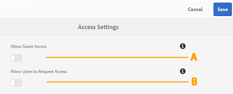
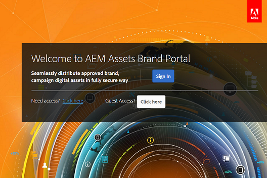

# Administrer l’accès des utilisateurs et utilisatrices sur Brand Portal {#administer-user-access-on-brand-portal}

À compter de la version 6.4.2, Adobe Experience Manager Assets Brand Portal autorise les administrateurs à configurer l’accès des invités et permet aux utilisateurs de demander l’accès sur le Brand Portal de leur entreprise. Ces configurations sont proposées sous forme de configurations de **[!UICONTROL Paramètres d’accès]** dans le panneau d’administration. Les deux paramètres sont désactivés par défaut.

**A** - Configuration pour permettre aux invités d’accéder à Brand Portal à l’aide du lien **[!UICONTROL `Guest Access?`]** sur l’écran d’accueil de Brand Portal. (désactivée par défaut).

**B** - Configuration pour permettre aux utilisateurs de demander l’accès à Brand Portal à l’aide du lien **[!UICONTROL `Need access?`]** sur l’écran d’accueil de Brand Portal. (désactivée par défaut).

## Autoriser l’accès des invités {#allow-guest-access}

En autorisant l’accès des invités, les utilisateurs peuvent accéder aux ressources publiques sans avoir à se connecter à Brand Portal.
Pour autoriser l’accès des visiteurs et visiteuses anonymes, l’administrateur ou l’administratrice doit procéder comme suit :

1. Sélectionnez le logo AEM pour accéder aux outils d’administration dans la barre d’outils supérieure.
1. Dans le panneau Outils d’administration, sélectionnez **[!UICONTROL Accès]** pour ouvrir la page **[!UICONTROL Paramètres d’accès]**.
1. Activez la configuration **[!UICONTROL Autoriser l’accès des invités]**.
1. **[!UICONTROL Enregistrez]** les modifications.
1. Déconnectez-vous pour que les modifications soient prises en compte.

## Autoriser les utilisateurs à demander l’accès {#allow-users-to-request-access}

Les administrateurs peuvent autoriser les utilisateurs de l’entreprise à demander l’accès à Brand Portal à partir de l’écran de bienvenue. Toutefois, les administrateurs doivent activer la configuration **[!UICONTROL Autoriser les utilisateurs à demander l’accès]** afin que le lien de demande d’accès s’affiche sur l’écran de bienvenue.

Pour permettre aux utilisateurs de l’organisation de demander l’accès sur Brand Portal, les administrateurs doivent :

1. Sélectionnez le logo AEM pour accéder aux outils d’administration dans la barre d’outils supérieure.
1. Dans le panneau Outils d’administration, sélectionnez **[!UICONTROL Accès]** pour ouvrir la page **[!UICONTROL Paramètres d’accès]**.
1. Activez la configuration **[!UICONTROL Autoriser les utilisateurs à demander l’accès]**.
1. **[!UICONTROL Enregistrez]** les modifications.
1. Déconnectez-vous pour que les modifications soient prises en compte.
